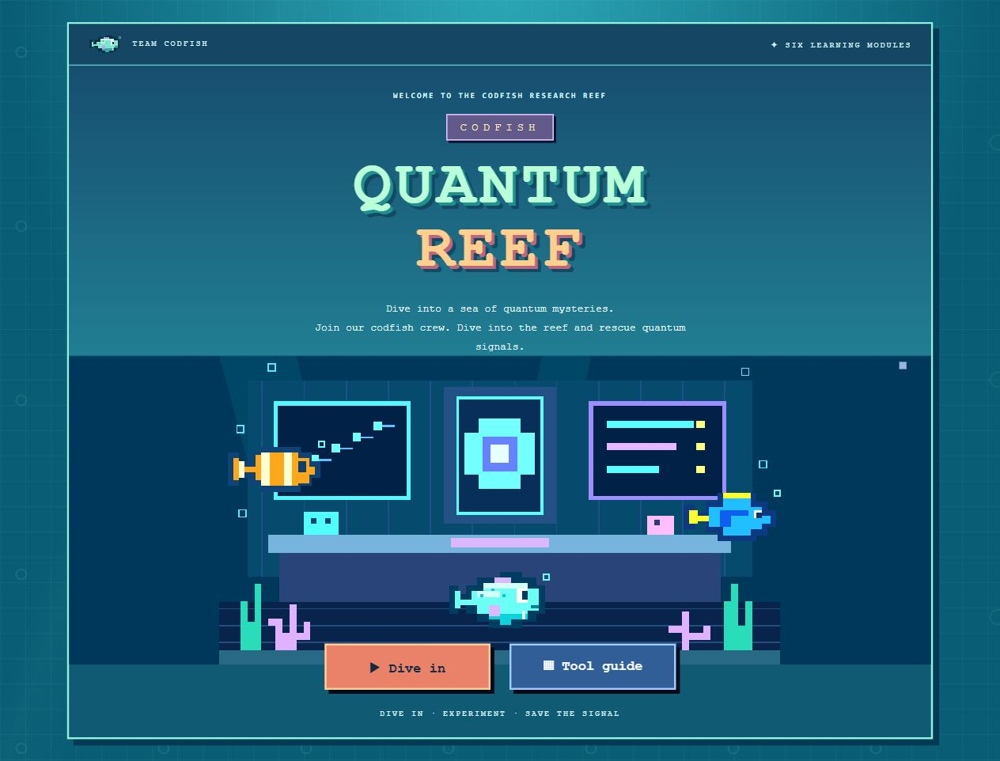
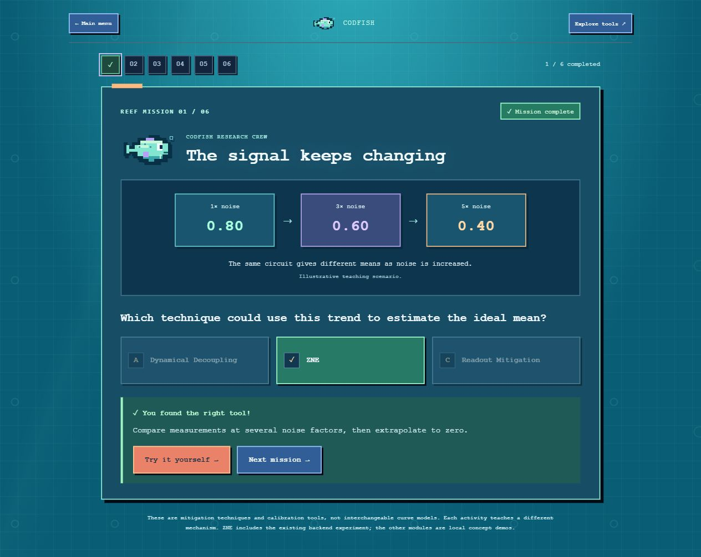

# CODFISH — Quantum Reef

A playable prototype about protecting a quantum computation against noise: four browser-based labs, each backed by a real Qiskit circuit or error model, where the player learns *how* to protect a computation and immediately sees the quantitative cost and payoff of that choice. Built with React, Python/FastAPI, and Qiskit (Aer simulator, with an optional real-IBM-hardware path). Runs on macOS, Windows and Linux.




---

## Problem and goal

**Theme.** Open-challenge prompt: *players make decisions about protecting a quantum computation against errors; player chooses to connect to a real quantum experiment or error model, and the consequences are shown quantitatively.*

**Technical track chosen: Error mitigation.** Four labs mitigation strategies for 4 different types of error found in quantum experiments. The breakdown of our educational toolkit is listed below:

| Lab | Technical category | Why it's included here |
|---|---|---|
| **ZNE** — Noise Detective | Error mitigation (the chosen track) | Canonical case: amplify noise at known factors, extrapolate back to zero. |
| **Readout mitigation** — Detector Decoder | Error mitigation (classical post-processing) | A second, independent mitigation technique with its own ideal reference and budget (number of calibration circuits), used for a controlled strategy-vs-baseline comparison. |
| **Dynamical decoupling** — Pulse Patrol | Error *suppression* (not mitigation — this distinction is made explicit in-app and in `backend/dd_demo/README.md`) | DD costs no extra shots and is the standard complement to mitigation; including it lets the player compare a during-the-run defense against after-the-run corrections on the same kind of noise (dephasing). |
| **Pauli twirling** — Shuffle the Error | Noise *tailoring* (neither suppression nor mitigation) | Twirling is what makes gate noise look like the Pauli channel that ZNE and PEC assume; it is the cleanest lab for teaching a *correctly predicted null result* (see Results). |

The **Error Mitigation Gamefiyed: Qubits vs Noise** game is a fifth, separate piece to understand quantum error correction with allegories: a plants vs zombies that teaches *which* technique counters *which* error type, under an in-game "Shots" economy. Error Mitigation tools have different attack affects on the incoming quantum error monsters.

**Player objective, actions and budget.** Every lab follows the same shape — get a technique-corrected estimate as close as possible to a known ideal reference, by spending a stated resource on a chosen technique — but each lab puts the player in front of a different physical problem:

| Lab | Player objective | Player actions | Resource budget |
|---|---|---|---|
| **ZNE** — Noise Detective | Three noisy measurements, taken at amplified noise levels, are on screen. Guess what the circuit would read with *zero* noise. | Pick an extrapolation model (linear or exponential); choose how many shots to spend per noise factor; drag a prediction marker to the zero-noise point before revealing the fit. | Measurement shots, spent 3× over (once per noise factor `{1,3,5}`) — 12,000 shots in this README's reproduced run. |
| **Dynamical decoupling** — Pulse Patrol | A qubit is idling and losing its state to slow drift. Keep it alive as long as possible before measuring. | Choose a pulse sequence (none / Hahn / CPMG / XY4 / an IBM runtime option) and where to place pulses across the idle window. | No extra shots — the cost is extra gates (pulses) inserted into the circuit, which add depth and their own small error. |
| **Pauli twirling** — Shuffle the Error | A noisy quench circuit's magnetisation is off from the ideal value. Recover it — or correctly conclude that nothing recovers it, if the noise can't be twirled away. | Choose how many random Pauli-frame randomizations to run, and which noise scenario (coherent, stochastic, both, or clean) to test against. | Measurement shots, split across randomizations — more randomizations average away more of the random-frame noise, at proportional shot cost. |
| **Readout mitigation** — Detector Decoder | A detector misreads some fraction of its measurements. Calibrate it against known inputs, then correct an unknown measurement back toward the truth. | Choose a calibration strategy: cheap (tensored, 2 circuits, assumes qubits misread independently) vs. expensive (correlated, `2ⁿ` circuits, assumes nothing). | Calibration circuits (2 to `2ⁿ`, capped at 16 for hardware runs) plus the shots spent on each one. |

**Success metric used throughout this README:** on a documented test case and a stated budget, a technique "succeeds" if the corrected estimate's absolute error against the ideal reference is lower than the raw/unmitigated estimate's error. Where theory predicts a technique should do *nothing* (e.g. twirling a channel that is already a Pauli channel), success instead means the measured shift is statistically indistinguishable from zero at a pre-registered threshold — correctly reproducing a negative result is treated as a valid, reportable outcome, per the challenge's own framing ("a careful experiment with a negative result is valid").

**Scope.** Simulator execution (Qiskit Aer, plus closed-form/NumPy teaching models) is the baseline for every lab

---

## Data and assumptions

No external dataset is used. With two types of Quantum Circuit Models (Real IBM QPU and Qiskit AER)

1. **Qiskit Aer circuit simulation** — a real circuit run through `AerSimulator` with an explicit, labeled noise channel (e.g. ZNE's Aer mode: 2-qubit depolarizing error of rate 0.003 or 0.015 per CX gate — a chosen parameter, not a calibrated IBM device model). This is the "simulator execution" the challenge says is sufficient.
2. **Real IBM hardware measurements** — bundled JSON files from actual jobs run on `ibm_quebec`, requires IBM PINQ^2 API Token ENV variable.

**Obtaining more data (optional, not required to reproduce the results below).** Running the labs' IBM-hardware paths needs API credentials, which are intentionally not in the repo. This project targets the **shared PINQ² allocation** used for Qiskit Fall Fest, but any personal IBM Quantum API token works identically:

1. Copy `backend/.env.example` to `backend/.env`.
2. Paste the token into `IBM_QUANTUM_TOKEN` (PINQ² organizers distribute this privately, or use your own IBM Quantum account token).
3. Run `python backend/verify_ibm_connection.py` to list backends your token can reach, and paste one into `IBM_BACKEND`.
4. Set `IBM_ENABLE=true` and restart the backend (`./start-local.sh`).

---

## Approach

**Stack.** React (Vite) frontend ↔ FastAPI backend ↔ Qiskit. Each lab is a self-contained Python package under `backend/<name>_demo/` (physics, noise model, a standalone CLI `main.py`, and its own test suite) wrapped by a thin FastAPI router (`backend/<name>_api.py`) that the matching React component (`frontend/src/<Name>Game.jsx`) calls over HTTP. This mirrors across all four labs, which is why the rest of this section can describe the pattern once and then the four specific instances.

**Qiskit's role**, concretely:
- **Circuit construction** (`qiskit.QuantumCircuit`): every lab's payload circuit — ZNE's folded RY+CX circuit, DD's prepare/idle/un-prepare Ramsey circuit, twirling's Trotterized transverse-field-Ising quench, readout mitigation's calibration + GHZ circuits.
- **Ideal reference values** (`qiskit.quantum_info.Statevector`/`Operator`): computed once, noiselessly, from the same circuit object the noisy runs use, so the "ideal" line a player compares against is guaranteed to be the *noiseless version of the exact circuit being run*, not a separately-derived number.
- **Simulated noise** (`qiskit_aer.AerSimulator` + `qiskit_aer.noise`): density-matrix simulation with an explicit depolarizing or coherent-unitary error channel, for ZNE and twirling's Aer modes.
- **Real hardware execution** (`qiskit_ibm_runtime.QiskitRuntimeService` / `SamplerV2`): transpilation with a fixed `initial_layout` and `seed_transpiler`, with the Sampler's own automatic dynamical decoupling and gate/measurement twirling explicitly disabled (`sampler.options.dynamical_decoupling.enable = False`, etc.) so that the *only* protection applied is the one this code adds — otherwise a comparison against "no DD" or "no twirling" would be comparing against IBM's own defaults, not against nothing.
- **Classical post-processing** (NumPy/SciPy, outside Qiskit): counts → means/uncertainty (`backend/core.py`), curve fitting for ZNE (`scipy.optimize.curve_fit`, weighted), matrix inversion and non-negative least squares for readout mitigation (`scipy.optimize.nnls`).


---

## Setup and execution

**Dependencies.** Python 3.12+ (tested on 3.12–3.14) and Node.js 22.12+. Exact pinned versions: `qiskit==2.5.2`, `qiskit-aer==0.17.2`, `qiskit-ibm-runtime==0.47.0` (`backend/requirements.txt`); frontend `react@19.1`, `vite@7.3.6` (`frontend/package.json`). The standalone DD demo is additionally tested against `qiskit-ibm-runtime==0.50.0` and reports both versions behave identically for its offline paths.

**Install:**

```zsh
python3 -m venv .venv
source .venv/bin/activate
pip install -r backend/requirements.txt
npm --prefix frontend ci
```

(Windows: see the PowerShell commands below the macOS/Linux block — same packages, `.venv\Scripts\python.exe` / `npm.cmd` in place of `python3`/`npm`.)

```powershell
python -m venv .venv
.\.venv\Scripts\python.exe -m pip install -r backend/requirements.txt
npm.cmd --prefix frontend ci
```

**The manageable way to reproduce the main result (no server, no network, ~5 seconds):** the ZNE package's own CLI runs the synthetic-teaching and Aer-simulated comparisons directly:

```zsh
.venv/bin/python backend/zne_demo/main.py teaching --model linear      --shots 4000 --seed 42
.venv/bin/python backend/zne_demo/main.py teaching --model exponential --shots 4000 --seed 42
.venv/bin/python backend/zne_demo/main.py aer       --model exponential --shots 4000 --seed 42
```

Each prints the three per-factor measurements, the extrapolated estimate with its uncertainty, and (for `teaching`) statistical warnings (trend/fit p-values) computed by `backend/zne_demo/src/analysis.py:fit`. Runtime: the two `teaching` commands finish in well under a second each; `aer` (a real density-matrix circuit simulation) takes a few seconds. These are exactly the numbers quoted in Results below — rerunning them with the same `--seed` reproduces them exactly, since the synthetic/Aer sampling is seeded.

**Running the other three labs' own CLIs** (equivalent "no server" reproduction for each; see each package's own README for full option lists):

```zsh
.venv/bin/python backend/twirl_demo/main.py aer                         # ~1s, no extra install
.venv/bin/python backend/trex_demo/main.py theory                       # <1s, no extra install
.venv/bin/python backend/dd_demo/main.py theory                         # needs: pip install -r backend/dd_demo/requirements.txt (adds matplotlib)
```

**Running the full web app** (all four labs playable in the browser, plus the Qubits vs Noise front end):

```zsh
python3 -m venv .venv && source .venv/bin/activate
pip install -r backend/requirements.txt
npm --prefix frontend ci
./start-local.sh            # or: python start_local.py --open
```

`start_local.py` picks free ports (defaults 8000/5173, advancing if occupied), waits for both servers, prints the `Ready:` URL, and stops both on Ctrl+C. Logs go to `.local/`. Windows: `.\.venv\Scripts\python.exe start_local.py --open` after the PowerShell install block above.

**IBM hardware mode .** Off by default. To turn it on, see "Obtaining more data" above (`backend/.env`, `IBM_ENABLE=true`, `IBM_QUANTUM_TOKEN`, `IBM_BACKEND`). With it on, the same four labs' "IBM lab" tabs can submit real jobs through `qiskit_ibm_runtime.SamplerV2`; without it, those tabs show a clear "IBM runs are disabled" notice and every other part of the app (including the results in this README) is unaffected.

**Automated tests** (what's checked on every change, no IBM job submitted by any of them):

```zsh
.venv/bin/python -m unittest discover -s backend/tests -v      # 72 tests: API, ZNE, DD, twirling, readout mitigation, all IBM paths mocked
npm --prefix frontend run test:unit                             # 34 tests: Qubits vs Noise engine, incl. "is every level winnable?"
npm --prefix frontend run build                                 # production build sanity check
```

Standalone per-module suites (need each module's own `requirements.txt` layered on top of `backend/requirements.txt`):

```zsh
(cd backend/dd_demo    && ../../.venv/bin/python -m pytest -q)
(cd backend/twirl_demo && ../../.venv/bin/python -m pytest -q)
(cd backend/trex_demo  && ../../.venv/bin/python -m pytest -q)
```

Browser end-to-end tests (needs both servers already running via `start-local.sh`):

```zsh
cd frontend && npx playwright install chromium
ZNE_TEST_URL=http://127.0.0.1:5173 npx playwright test   # use the launcher's actual port
```

All of the above (install → ZNE CLI → full unittest suite → frontend unit tests → build) completes in well under two minutes on a laptop; the slowest single step is `npm ci`.

**Repository layout**, for orientation:

| Path | What's there |
|---|---|
| `frontend/src/{ZNEGame,DDGame,TwirlGame,TRexGame}.jsx` | The four labs' interactive UI |
| `frontend/src/LearningHub.jsx`, `QubitsVsNoise.jsx`, `qvn/` | Toolkit hub and the Qubits vs Noise mission front end |
| `backend/app.py` | FastAPI app setup; mounts each lab's router |
| `backend/{zne,dd,twirl,trex}_api.py` | Each lab's REST endpoints (levels/play/explore/hardware) |
| `backend/{zne,dd,twirl,trex}_demo/` | Each lab's standalone, independently-testable Qiskit package + CLI + its own README |
| `backend/ibm_adapter.py`, `backend/core.py` | Shared IBM Runtime connection and shot-counting/fitting helpers |
| `backend/tests/`, `frontend/unit/`, `frontend/tests/` | Backend unittest suite, frontend engine unit tests, Playwright e2e |
| `docs/ZNE-technical-notes.md` | Extended ZNE derivation notes |

---

## Experiments

What was actually run, and what each one was testing:

| # | Lab | What was compared | Settings / budget | Test case |
|---|---|---|---|---|
| 1 | ZNE | Raw (factor 1) vs. linear-fit vs. exponential-fit estimate | 4,000 shots/factor, factors `{1,3,5}`, seed 42 | Synthetic teaching data, two noise profiles (linear decay, exponential decay) |
| 2 | ZNE | Raw vs. exponential-fit estimate, on a *real simulated circuit* (not synthetic numbers) | 4,000 shots/factor, Aer density-matrix sim, 2-qubit depolarizing @ 0.015/CX, seed 42 | The actual folded RY+CX circuit |
| 3 | Pauli twirling | Unmitigated vs. twirled magnetisation, across four noise regimes | 16 randomizations × 512 shots/treatment, seed 7 | Coherent-only, stochastic-only, both, and no noise |
| 4 | Readout mitigation | Tensored (cheap) vs. correlated (expensive) calibration | 2 vs. 16 calibration circuits, 4 qubits | Independent-bias level, crosstalk level, GHZ parity level |
| 5 | Dynamical decoupling | No DD vs. `runtime-XX` vs. `runtime-XY4` vs. manually-inserted `XX` | 2,000 shots/point (run A) and 1,000 shots/point (run B), real `ibm_quebec`, qubit 5 | Idle-and-measure Ramsey experiment, two separate days |

**Unsuccessful or corrected experiments that affect the conclusions (reported):**

- **Readout-noise simulation via `qiskit_aer.noise.ReadoutError`** was the first approach tried for the readout-mitigation lab's simulated levels. It silently produced *no effect* under this project's qiskit-aer 0.17.2, because Aer compiles a multi-qubit `measure` into independent single-qubit measurement instructions, defeating a correlated `ReadoutError`. This was caught, and the simulated levels now sample a hand-written NumPy Markov channel instead (`backend/trex_demo/src/noise.py`), with the reason documented in that file's docstring. This is a negative result about a *library's* behavior, not about readout mitigation itself, but it shaped the implementation and is disclosed per the rubric's "unsuccessful experiments that affect your conclusions."
- **A false "twirling helps" signal from correlated RNG seeding.** An early version of the twirling Aer comparison submitted the bare and twirled circuit batches in a single `AerSimulator.run()` call. Aer's per-circuit seeding by job position correlated the two batches' sampling noise and produced a spurious ~4σ "improvement" on a channel (pure depolarizing) that theory says twirling cannot touch. This was caught by the module's own self-tests, fixed by giving every circuit its own explicit seed in its own `run()` call (`backend/twirl_demo/src/simulate.py`), and is documented as a limitation in `backend/twirl_demo/README.md` so the same mistake isn't repeated if that loop is refactored for speed.
- **DD's `--fake` (offline FakeTorino) dry run shows no DD benefit at all** — not a bug, but a limitation worth stating: the fake backend models only T1/T2 relaxation, which pulse sequences cannot fix. It verifies the *code path* (transpile → add pulses → submit → parse), not the physics. The physics claims in Results below come only from the real-hardware runs and the Aer/theory simulations, never from `--fake`.
- **ZNE has not been run on real IBM hardware.** The submission code path (`backend/ibm_adapter.py` / `backend/zne_demo/src/hardware.py`) is unit-tested against a mocked `QiskitRuntimeService` (`backend.tests.test_zne_precision`), and its gate-folding and ISA-validity checks are exercised there, but no real job has been submitted. This is stated plainly rather than implied — see Discussion.

**Proposed but not implemented** (listed here, not claimed as done): measurement twirling for readout mitigation (randomizing which physical bit maps to which classical bit, the other half of what IBM calls "TREX"); chaining twirling before ZNE and checking whether the extrapolation behaves better on twirled data; repeated-pulse DD trains for long idle windows; a Bell-pair DD experiment; error bars from repeated hardware runs over time. These are recorded as next steps in Conclusions and in each module's own README, not presented as completed work.

---

## Results

### 1 & 2 — ZNE: raw vs. extrapolated estimate (ideal reference = 0.9 exactly)

| Source | Raw (factor 1) | Linear-fit estimate | Exponential-fit estimate |
|---|---|---|---|
| Synthetic teaching data, linear-decay profile | 0.8055 ± 0.0094 (error **0.0945**) | 0.8978 ± 0.0121 (error **0.0022**) | — |
| Synthetic teaching data, exponential-decay profile | 0.7290 ± 0.0108 (error **0.171**) | — | 0.8996 ± 0.0197 (error **0.0004**) |
| Aer circuit simulation (2-qubit depolarizing, 0.015/CX) | 0.8005 ± 0.0095 (error **0.0995**) | — | 0.9311 ± 0.0156 (error **0.0311**) |

Shot cost: 4,000 shots × 3 factors = 12,000 shots per estimate, in every row. On the synthetic data the extrapolated estimate is **20–400× closer** to the ideal reference than the raw measurement, well inside its own fit uncertainty. On the real simulated circuit the improvement is smaller but still clear (**3.2× closer**), and the fit's own reported uncertainty (0.0156) does *not* cover its error (0.0311) — the fit is confidently biased, not just uncertain. This is exactly the distinction the lab's own code flags: `fit()` returns `uncertainty_note: "Local fit uncertainty only; does not include model bias."`

### 3 — Pauli twirling: unmitigated vs. twirled magnetisation (4 qubits, 4 Trotter steps, ideal `m = +0.5259`)

| Scenario | Unmitigated error | Twirled error | Shift vs. 3σ threshold | Verdict |
|---|---|---|---|---|
| Coherent ZZ crosstalk only | 0.1188 | **0.0129** | 0.1060 vs. 0.0357 | **Twirling improved the result** |
| Stochastic depolarizing only | 0.1409 | 0.1372 | 0.0037 vs. 0.0298 | **No change** (correctly predicted null result) |
| Both at once | 0.2278 | 0.1431 | 0.0847 vs. 0.0338 | **Improved**, landing on the stochastic floor |
| No injected noise | 0.0034 | 0.0007 | 0.0027 vs. 0.0279 | **No change** (nothing to twirl) |

Budget: 16 randomizations × 512 shots per treatment = 8,192 shots per treatment, 16,384 total per scenario. The coherent-noise result is the headline positive case (error cut ~9×); the stochastic-noise result is the headline *negative* case, and it is exactly what Pauli-twirling theory predicts (a depolarizing channel is already its own Pauli twirl) — reported as a success for the experiment design, not a failure of the technique.

### 4 — Readout mitigation: tensored vs. correlated calibration

| Level | Tensored (2 circuits) | Correlated (16 circuits) | Target |
|---|---|---|---|
| Independent bias, 1 qubit | score 0.0099, **pass** | (identical for 1 qubit) | ≤ 0.02 |
| 4 independent detectors | score 0.0242, **pass** | — (not needed) | ≤ 0.03 |
| 4 detectors with crosstalk | score 0.1097, **fail** | score 0.0337, **pass** | ≤ 0.04 |
| GHZ parity (4 qubits) | raw +0.592 → corrected **+0.987** | raw +0.620 → corrected **+0.986** | ≤ 0.05 of +1 |

The crosstalk level is the controlled strategy-vs-baseline comparison required by the rubric: the cheap (tensored) calibration *fails* its target regardless of shot count, because its independence assumption is wrong for this test case, while the expensive (correlated) calibration succeeds — at 8× the calibration-circuit cost. Both reproduce from the same seed via `python backend/trex_demo/main.py theory`.

**Real hardware** (`ibm_quebec`, 2026-10-07, tensored calibration, 4 qubits, 2,000 shots, job `db3cnu2mb58s7387h0tg`, file `backend/trex_demo/results/trex_ibm_quebec_20261007-184730.json`): raw total-variation distance to the ideal GHZ distribution **0.038** → corrected **0.0229**, a **~40% reduction**, with assignment-matrix condition number 1.04 (well-conditioned). This is the one lab in this project with a confirmed real-hardware mitigation result from the actual web submission path (not just the CLI or a mock).

### 5 — Dynamical decoupling: real hardware, two independent days

`ibm_quebec`, qubit 5, `init y` (prepares `|+i⟩`). `P(0) = 1.0` means the state survived; `0.5` means fully scrambled.

**Run A — 2026-10-05, 2,000 shots/point** (`hardware_ibm_quebec_20261005-231055.json`):

| idle (µs) | none | runtime-XX | runtime-XY4 | manual-XX |
|---|---|---|---|---|
| 25 | 0.77 | 0.95 | 0.96 | 0.95 |
| 50 | 0.60 | 0.90 | 0.90 | 0.91 |
| 100 | 0.24 | 0.76 | 0.75 | 0.85 |
| 150 | 0.27 | 0.61 | 0.63 | 0.81 |
| 200 | 0.51 | 0.51 | 0.52 | 0.76 |

**Run B — 2026-10-06, 1,000 shots/point** (`hardware_ibm_quebec_20261006-004819.json`):

| idle (µs) | none | runtime-XX | runtime-XY4 |
|---|---|---|---|
| 16.6 | 0.24 | 0.97 | 0.98 |
| 33.3 | 0.64 | 0.94 | 0.97 |
| 50.0 | 0.51 | 0.92 | 0.92 |
| 66.7 | 0.27 | 0.87 | 0.86 |
| 83.3 | 0.70 | 0.81 | 0.82 |
| 100.0 | 0.20 | 0.79 | 0.79 |

Both runs tell the same qualitative story — the undefended baseline is far below any DD-protected curve at matched idle times — but the *shape* of the baseline is not reproducible day-to-day (Run A decays roughly monotonically before turning back up near 200µs; Run B oscillates by as much as 0.5 between adjacent points, even at 16.6µs). The DD-protected curves are comparatively stable across both runs. This is read as evidence that (a) DD's benefit on this qubit is robust day-to-day, and (b) the *undefended* baseline alone, on one qubit, is not a reliable characterization of the device — see Discussion.

All raw JSON (counts, job IDs, exact delays) backing these tables is committed in the repo at the paths named above and in `backend/twirl_demo/results/` / `backend/zne_demo`'s run store (empty for ZNE, by design — see Experiments).

---

## Discussion and limitations

**What worked.** All four labs reproduce their technique's textbook behavior at least once on simulator, and two of the four (DD, readout mitigation) reproduce it on real hardware. The most valuable single result is arguably the stochastic-noise twirling case: a *statistically gated* (3σ) correct null result is harder to get right than a cherry-picked positive one, and it is exactly the check that caught the seeding bug described in Experiments — meaning the test harness itself did its job.

**What didn't, or only partly.** ZNE's Aer-simulated extrapolation improves on the raw estimate but is measurably biased (error exceeds the fit's own reported uncertainty) — a reminder that a weighted least-squares fit's confidence interval is not a guarantee against the wrong functional form, exactly as `fit()`'s own `uncertainty_note` warns. The readout-mitigation crosstalk model is a hand-built convex mixture ("both flip together" vs. independent), not derived from a physical crosstalk mechanism — it is a teaching device, not a device characterization. The DD baseline's day-to-day irreproducibility (Run A vs. Run B above) means neither run alone should be read as "this is what P(0) looks like on `ibm_quebec`" — only the *relative* gap between `none` and the DD modes, measured within the same job, is a fair comparison, which is why every lab submits its treatments in one job rather than separate ones (documented in each module's README).

**Sources of error, by lab:**
- ZNE: finite-shot sampling noise (reported, via Jeffreys-smoothed standard error) and extrapolation model bias (not reported by the fit itself, only visible by comparing to the known reference — which is only possible because this is a toy circuit with a computable ideal answer).
- DD: device drift between the two real-hardware sessions; the published pulse sequences cannot distinguish a steady frequency offset (coherent rotation, visible as `P(0)` dropping below 0.5) from scrambling (dephasing) without more points than were collected.
- Twirling: Trotter error (gap between the "ideal" and "exact" references) is present in every scenario, including `clean`, and is untouched by twirling by construction — it bounds how close *any* mitigation can get.
- Readout mitigation: the non-negative-least-squares correction trades a small, systematic bias for staying physical (never negative) — visible directly in the GHZ level's "inverted vs. corrected" comparison.

**How far this generalizes.** Not very, by design: every circuit here is small (1–4 qubits) and chosen to make one mechanism legible, not to model an application circuit or a specific device's calibrated noise. The hardware results are single-qubit-or-few-qubit, single-session snapshots (DD: one qubit, two days; readout mitigation: one 4-qubit GHZ state, one session). The findings should be read as "this technique behaves as the textbook predicts, in a setting small enough to verify by hand," not as a claim about mitigation payoff at circuit sizes where the ideal reference can no longer be computed exactly.

**What the game teaches, and what it simplifies away** (the rubric asks for this explicitly):
- *Teaches:* that different noise sources need different countermeasures (idle-time dephasing wants suppression; a biased detector wants classical post-processing inversion; coherent gate errors respond to randomization in a way stochastic errors do not); that every countermeasure has a budget, not just an effect; that a technique can legitimately do nothing, and that this is a predictable, checkable outcome rather than a failure.
- *Simplifies:* no crosstalk between circuit qubits and un-involved spectator qubits; no T1 energy relaxation model (DD's experiment is purely dephasing); readout mitigation's crosstalk is a toy mixture, not measured; ZNE folds a 2-qubit circuit by hand rather than using resilience-level options a real workflow would reach for; the Qubits vs Noise mission's "Shots economy" and ×2/×½ damage multipliers are game-balance numbers, not derived from any of the four labs' actual statistics.

---

## Conclusions

**Original question:** can a player's choice of protection technique, made under a stated and visible resource budget, measurably move a noisy quantum estimate back toward its known ideal value — and can the same setup correctly show a player when a technique does *not* help?

**Answer, from the evidence above:** yes to both. Three independent techniques (ZNE, Pauli twirling, readout mitigation) each reduced the error between a noisy estimate and its ideal reference by roughly 3× to >100×, at a stated and displayed shot/circuit cost, on both synthetic/simulated data and — for readout mitigation and dynamical decoupling — on real IBM hardware. The project also deliberately includes and correctly reproduces the negative case (twirling a stochastic/Pauli channel does nothing, confirmed at 3σ), which the challenge explicitly treats as valid evidence rather than a shortcoming. ZNE's real-hardware path remains unverified; that gap is stated rather than implied, and is the most direct next step.

**Useful next steps**, by priority:
1. Submit a real ZNE job and close the one remaining "simulator only" gap among the four labs.
2. Measurement twirling for readout mitigation (randomize the classical-bit mapping shot-to-shot), the half of IBM's "TREX" not yet implemented.
3. Repeat the DD and readout-mitigation hardware runs several times over a few hours to put honest day-to-day error bars on the numbers in Results, rather than treating single sessions as representative.
4. Chain twirling before ZNE on the same circuit, to check (rather than assume) that pre-tailored noise makes the extrapolation fit better.

---

## Sources and contributions

**External sources and attribution:**
- [`quantumGame`](https://github.com/EDHE08232001/quantumGame) — the original tower-defense engine ported (largely unchanged: `frontend/src/qvn/engine.js`, `data.js`, `levels.js`, `constants.js`) and restyled as the Qubits vs Noise reef mission.
- Zero-noise extrapolation: Temme, Bravyi & Gambetta, *"Error Mitigation for Short-Depth Quantum Circuits"* (2017), and the Qiskit Runtime resilience documentation (this project implements folding by hand rather than using that built-in feature — see Approach — but follows the same extrapolation idea).
- Pauli twirling / randomized compiling: Wallman & Emerson, *"Noise tailoring for scalable quantum computation via randomized compiling"* (2016); Qiskit's own gate-twirling option in `SamplerV2` (`options.twirling`), which this lab deliberately disables so the twirling shown is only the one implemented in `backend/twirl_demo/src/twirl.py`.
- Dynamical decoupling sequences: Hahn echo (Hahn, 1950), CPMG (Carr–Purcell–Meiboom–Gill), XY4, and Uhrig Dynamical Decoupling (Uhrig, 2007).
- Readout-error mitigation: the tensored-vs-correlated calibration distinction follows the approach used by IBM's `mthree` (M3) library, cited by name in `backend/trex_demo/README.md`; "TREX" (Twirled Readout Error eXtinction) is IBM's name for calibration *plus* measurement twirling — this project implements only the calibration half, stated explicitly in that module's README.
- Qiskit, Qiskit Aer and Qiskit IBM Runtime documentation and tutorials (IBM Quantum), used throughout for API usage (`SamplerV2`, `generate_preset_pass_manager`, `AerSimulator`, noise-model construction).

**Team contributions** (from the repository's commit history):
- **PingYi,Tung** — initial project scaffold ("Add CODFISH Quantum Reef learning prototype"); extracted the ZNE module into its own package with Aer and IBM support; homepage two-column layout.
- **Edward He** — dynamical decoupling integration into the web app; ported and restyled the Qubits vs Noise mission (with AI pair-programming assistance, see below); repository README maintenance.
- **Hanna Paik** — the Pauli twirling module (`backend/twirl_demo`, `backend/twirl_api.py`, `TwirlGame.jsx`).
- **Thao Phan** — the readout-mitigation / Detector Decoder module (`backend/trex_demo`, `backend/trex_api.py`, `TRexGame.jsx`); overall integration, PR review and merges across all modules; this README.

Questions, corrections to the attribution above, or requests to extend any of the four labs are welcome — open an issue or see each lab's own `README.md` under `backend/<name>_demo/` for implementation detail this file intentionally summarizes rather than repeats.
